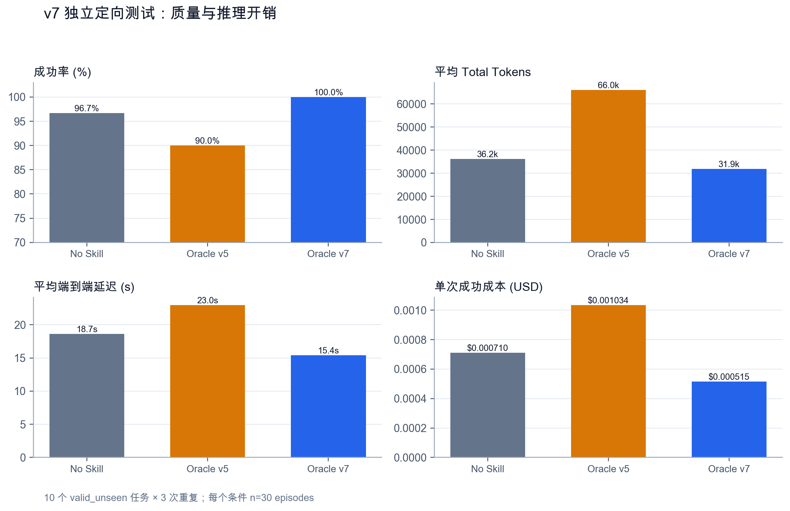
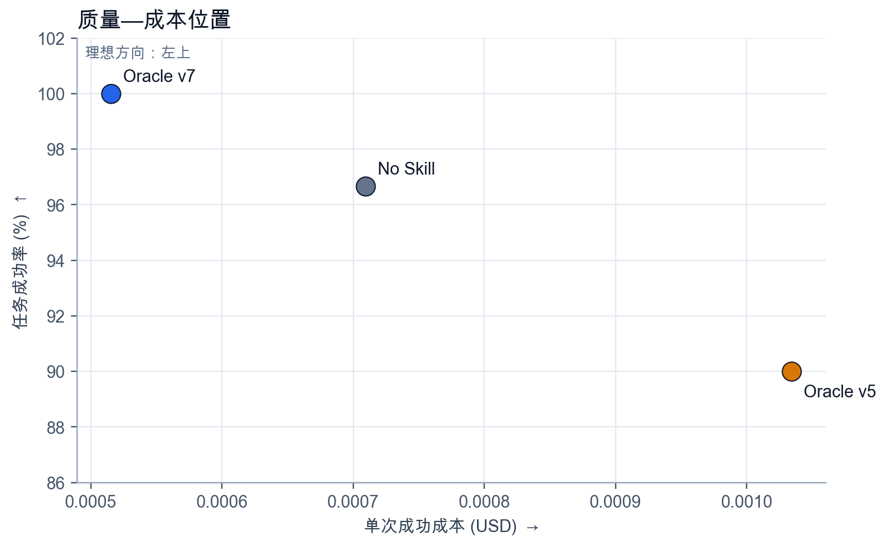
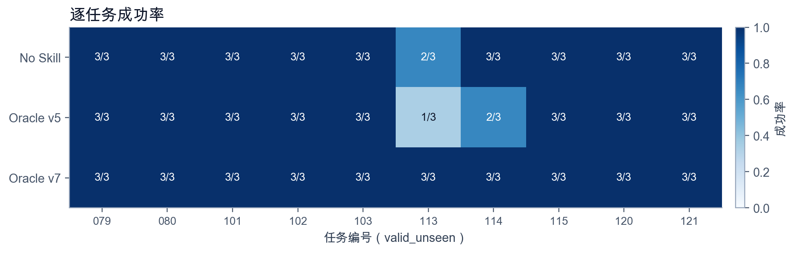
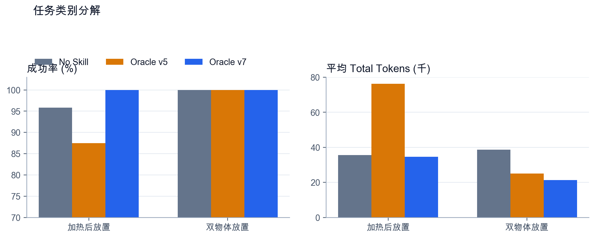

# 固定 Skill 能否提高 LLM Agent 的任务质量与推理效率？

本文由已发布 PDF 对应的 Word 原稿转换，并逐段、逐单元格核对 PDF。保留当时的数据、表述和后续计划；不代表最新结论。当前综合说明见[项目说明与结果复核](../../docs/PROJECT_SUMMARY.md)。

基于 DeepSeek-v4-flash 与 ALFWorld 的分阶段实验报告

## 技术摘要

第一轮正式实验没有证明固定 Skill 有效。30 道平衡任务、5 个条件、3 次重复共 450 个 episode 中，All Skills 的成功率最高，但相对 No Skill 只高 1.11 个百分点，任务级配对置信区间覆盖 0；No Skill 的 token 和成本最低。

在开发集重写 Oracle Skill 后，v7 在独立定向测试中取得 30/30，No Skill 为 29/30，旧版 Oracle v5 为 27/30。v7 同时比 No Skill 少用 11.8% 的 Total Tokens、降低 17.4% 的延迟，并将单次成功成本降低 27.4%。这些是有利的点估计，但 10 道任务不足以证明成功率差异显著。

当前最稳妥的结论是：旧版固定 Skill 没有普遍收益；经过针对性修改的 v7 在目标类别上显示了质量与成本同时改善的信号。下一步应冻结更大、类别平衡的新测试集，而不是继续修改这 10 道题。

## 1. 研究问题与实验路径

研究问题有两个：固定 Skill 是否提高任务成功率；如果成功率相近，它是否减少模型输入、输出、交互步数、时间和成本。所有成功标签均由 ALFWorld 环境返回，模型不参与评分。

| 阶段 | 数据用途 | 任务与条件 | 允许的结论 |
| --- | --- | --- | --- |
| v5 正式实验 | 独立测试 | 30 题×5 条件×3 次 | 评估初版 Skill 与 Router |
| v7 开发实验 | 开发与改写 | 20 题×3 条件×3 次 | 发现问题、修改 Skill，不作最终证明 |
| v7 定向测试 | 独立测试 | 10 题×3 条件×3 次 | 检验修改后的目标机制 |

表1  三阶段证据的用途。开发集与测试集分开解释。

## 2. 初版正式实验：Skill 没有形成稳定收益

| 方法 | 成功率 | Total Tokens | 延迟(s) | 成本/成功 |
| --- | --- | --- | --- | --- |
| No Skill | 97.78% | 28,612 | 16.67 | $0.000599 |
| Body-aware | 94.44% | 47,718 | 20.66 | $0.000830 |
| BM25 Body | 97.78% | 39,912 | 18.90 | $0.000696 |
| Oracle Skill | 95.56% | 43,433 | 19.15 | $0.000699 |
| All Skills | 98.89% | 95,278 | 23.23 | $0.000941 |

表2  v5 正式测试总体结果。每种条件 90 个 episode。

All Skills 为 98.89%，No Skill 为 97.78%。二者只差一次成功，配对重采样的 95% 置信区间为 -3.33 至 6.67 个百分点。All Skills 的平均 Total Tokens 是 No Skill 的 3.33 倍。这个结果支持一个负结论：把 Skill 放进上下文会增加负担，但初版 Skill 没有可证实的成功率收益。

## 3. v7 开发结果：更好的 Oracle 出现，但这不是最终证据

| 条件 | 成功率 均值±SD | Input | Output | Total | 延迟(s) | 成本/成功 | 工具调用 |
| --- | --- | --- | --- | --- | --- | --- | --- |
| No Skill | 93.3±2.9% | 60,166 | 1,266 | 61,432 | 33.59 | $0.000888 | 21.5 |
| Oracle v5 | 95.0±0.0% | 42,162 | 993 | 43,155 | 29.17 | $0.000712 | 18.4 |
| Oracle v7 | 98.3±2.9% | 48,061 | 1,269 | 49,331 | 30.25 | $0.000781 | 19.6 |

表3  v7 开发集结果。20 个 valid_seen 任务×3 次重复，每种条件 60 个 episode。

Oracle v7 的开发集成功率为 98.33%，高于 No Skill 的 93.33% 和 Oracle v5 的 95.00%。但 v7 是根据这批任务暴露的问题改写出来的，所以这张表只能说明设计方向值得测试，不能当作泛化证据。

## 4. 独立定向测试：v7 的质量与成本点估计同时改善

| 条件 | 成功率 均值±SD | Input | Output | Total | 延迟(s) | 成本/成功 | 工具调用 |
| --- | --- | --- | --- | --- | --- | --- | --- |
| No Skill | 96.7±5.8% | 35,015 | 1,176 | 36,191 | 18.65 | $0.000710 | 16.8 |
| Oracle v5 | 90.0±10.0% | 64,423 | 1,587 | 66,010 | 22.98 | $0.001034 | 19.8 |
| Oracle v7 | 100.0±0.0% | 31,109 | 804 | 31,913 | 15.41 | $0.000515 | 14.9 |

表4  v7 独立定向测试。10 个 valid_unseen 任务×3 次重复，每种条件 30 个 episode。

图1  独立定向测试的成功率与四项推理开销。

相对 No Skill，Oracle v7 的成功率高 3.33 个百分点；Input Tokens 变化 -11.2%，Output Tokens 变化 -31.7%，Total Tokens 变化 -11.8%，延迟变化 -17.4%，单次成功成本变化 -27.4%。

图2  独立定向测试的质量—成本位置。Oracle v7 位于左上方向。

在这批任务上，Oracle v7 没有用更长上下文换成功率，而是同时减少了 token、延迟、工具调用和成本。Oracle v5 的均值被一次 100 步、749,380 token 的失败轨迹显著拉高；因此成本优势不能只看均值，还要结合逐任务结果。

## 5. 不确定性：方向有利，证据量仍小

| 相对 No Skill | 成功率差 (pp) | 成功率差 95% CI | p | Total 差 | Total 差 95% CI |
| --- | --- | --- | --- | --- | --- |
| Oracle v5 | -6.67 | -16.67 至 0.00 | 0.218 | 29,819 | -8,301 至 95,870 |
| Oracle v7 | 3.33 | 0.00 至 10.00 | 0.691 | -4,278 | -17,765 至 10,299 |

表5  按任务成组、保留三次重复的配对 bootstrap（20,000 次）。

Oracle v7 的成功率差为 +3.33 个百分点，区间为 0 至 10 个百分点；双侧 bootstrap p=0.692。Total Tokens 的平均差为 -4,278，但区间跨过 0。样本量和任务异质性使区间较宽，不能把点估计写成统计显著的普遍提升。

## 6. 机制证据：v7 修复了目标物体绑定

图3  每个任务三次重复的成功次数。差异集中在任务 113 与 114。

| 任务类别 | 条件 | 成功 | 平均 Total | 工具调用 |
| --- | --- | --- | --- | --- |
| 加热后放置 | No Skill | 23/24 | 35,572 | 16.5 |
| 加热后放置 | Oracle v5 | 21/24 | 76,237 | 21.3 |
| 加热后放置 | Oracle v7 | 24/24 | 34,542 | 15.6 |
| 双物体放置 | No Skill | 6/6 | 38,666 | 17.8 |
| 双物体放置 | Oracle v5 | 6/6 | 25,100 | 13.7 |
| 双物体放置 | Oracle v7 | 6/6 | 21,396 | 12.0 |

表6  独立定向测试的类别分解。加热任务 8 道，双物体任务 2 道；每题重复 3 次。

图4  两类任务的成功率与平均 Total Tokens。

四次失败全部出现了目标物体混淆：任务要求 cup，轨迹却选择了 mug。其中 Oracle v5 有一次耗尽 100 步。Oracle v7 在任务 113 和 114 上均为 3/3，且整批测试无失败。这个轨迹证据与 v7 的设计目标一致，但它仍是窄机制证据：测试集有 8 道加热任务，不能外推到清洗、冷却、照明和一般放置任务。

## 7. 指标定义与复现规则

- Task Success Rate = 成功 episode 数 / episode 总数。成功由 ALFWorld 的 won=true 判定。

- Input Tokens 为全部模型调用输入 token 之和；Output Tokens 为全部模型输出 token 之和；Total Tokens = Input + Output。

- End-to-End Latency 覆盖路由、模型调用、环境交互和完成判定，单位为毫秒，报告中换算为秒。

- Cost per Successful Task = 该条件全部 episode 的模型成本 / 成功 episode 数。失败消耗也计入成本。

- Efficiency per 1k Tokens = Success Rate / Average Total Tokens × 1000。工具调用数是补充过程指标。

三个条件使用同一 DeepSeek-v4-flash、temperature=0、同一 Agent 协议和任务顺序。Oracle v5 与 Oracle v7 只改变加载的固定 Skill 版本；No Skill 不加载 Skill。独立测试文件已冻结并计算 SHA-256。

## 8. 结论边界与下一步

现有证据分成两层。第一层已经确定：初版 Skill 库没有普遍优势，过量 Skill 会显著增加上下文成本。第二层仍待确认：v7 在定向独立任务上出现了 100% 成功率和更低成本，但样本太小、类别不平衡，统计区间仍宽。

- 冻结 v7，不再根据这 10 道独立测试题改写 Skill。

- 从尚未使用的 valid_unseen 任务中预先冻结一个更大且类别平衡的确认集，继续采用同题同次配对。

- 主比较设为 Oracle v7 对 No Skill；成功率是主指标，Input、Output、Total Tokens、延迟和单次成功成本是共同报告的成本指标。

- 报告任务级 bootstrap 置信区间、逐任务失败矩阵与中位数，避免少数超长轨迹控制均值。

如果确认集仍显示质量和成本同时改善，才能把结论从“目标机制有效信号”推进到“固定 Skill 在 ALFWorld 上具有可重复收益”。如果成功率回落，v7 仍可保留为一次有解释力的失败分析案例。

## 数据与版本

独立测试运行：alfworld-v7-targeted-test-10x3；冻结记录：90；开发运行：alfworld-v7-oracle-dev-20x3；开发记录：180。

独立测试 SHA-256：5fcac9e5b23ec3b70bbefcc94330b048a71a2855995b1888b6bc7aea8b6b5f2e。分析表、失败轨迹摘要与图件位于 results/formal_v7。
