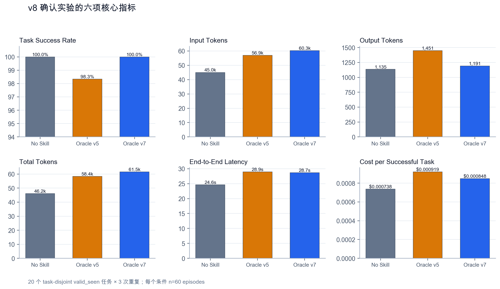
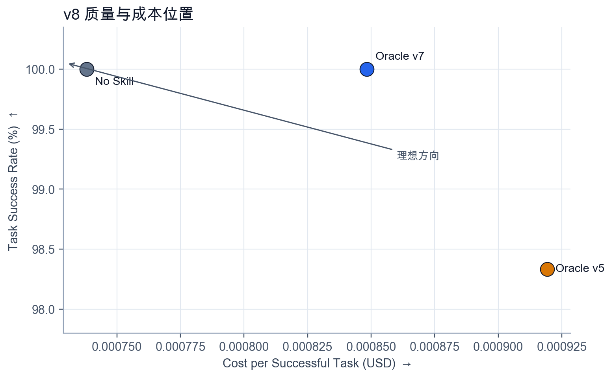
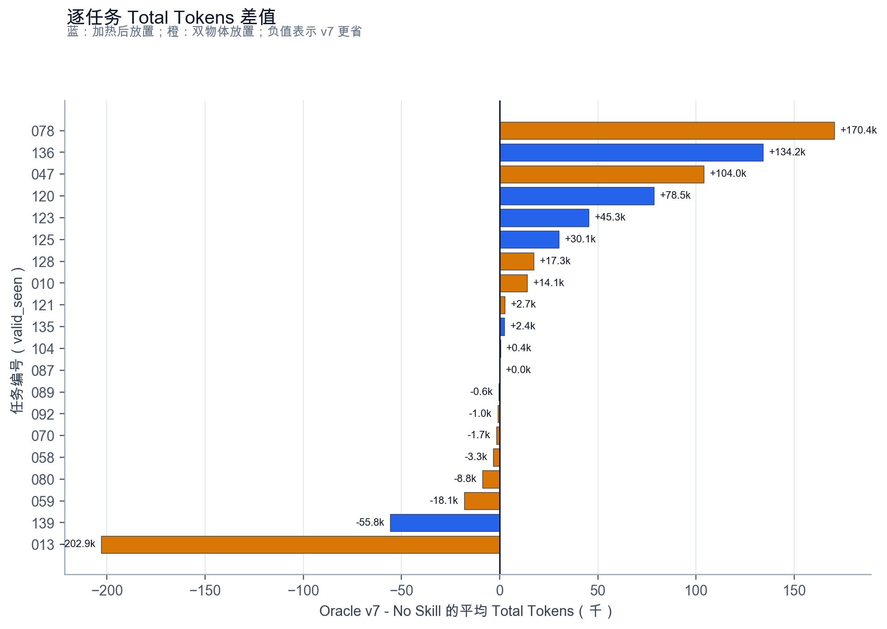
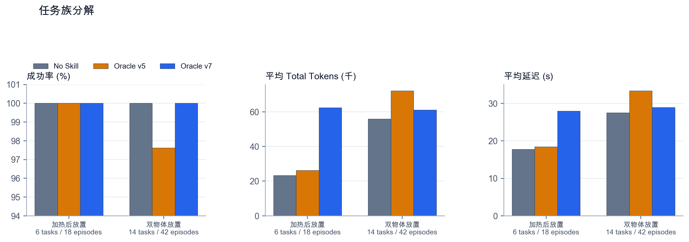

# 固定 Skill 在 ALFWorld 中的复现边界

本文由已发布 PDF 对应的 Word 原稿转换，并逐段、逐单元格核对 PDF。保留当时的数据、表述和后续计划；不代表最新结论。当前综合说明见[项目说明与结果复核](../../docs/PROJECT_SUMMARY.md)。

DeepSeek-v4-flash 的分阶段实验与 v8 确认结果

## 技术摘要

v8 没有复现 v7 定向测试中的效率优势。20 道与开发集不重叠的 valid_seen 任务、3 个条件、3 次重复共 180 个 episode 中，No Skill 与 Oracle v7 均为 60/60；Oracle v7 的平均 Total Tokens 高 33.3%，端到端延迟高 16.5%，单次成功成本高 15.0%。

配对 bootstrap 的成本区间均跨过 0，不能据此断言 Skill 必然增加成本。可以确认的是，v8 不支持“v7 在保持成功率的同时稳定降低推理开销”这一说法。聚合结果上，No Skill 在质量相同的情况下占用更少 token、时间和成本。

逐任务差异很大。Oracle v7 在 23/60 个配对 episode 中减少 Total Tokens，在 37/60 个中增加；差值中位数只有 +2,413，均值却是 +15,358。少数超长轨迹控制了均值，因此后续研究必须同时报告均值、中位数、任务级区间和逐题轨迹。

## 1. 证据链与确认问题

本项目先在 Mini Lab 验证 Agent、工具调用和自动评分，再进入 ALFWorld。v5 检验初版固定 Skill 与检索方法；v7 根据开发集暴露的目标绑定与动作语义问题改写两个 Oracle Skill；v8 用未参与开发的任务检查这一改写能否复现。所有成功标签都来自 ALFWorld 的 won 字段，模型不参与评分。

| 阶段 | 数据角色 | 规模 | 主要结论 |
| --- | --- | --- | --- |
| v5 正式实验 | 独立测试 | 30题×5条件×3次 | 初版 Skill 无稳定收益；All Skills 成本高 |
| v7 定向测试 | 窄范围独立测试 | 10题×3条件×3次 | v7 出现质量与成本同时改善的信号 |
| v8 确认实验 | 任务不重叠确认集 | 20题×3条件×3次 | 成功率持平，效率优势未复现 |

表1  三阶段数据用途。v8 与开发任务不重叠，但仍属于 valid_seen。

## 2. v8 的六项核心指标

| 条件 | 成功 | 成功率 | Input | Output | Total | 延迟(s) | 成本/成功 |
| --- | --- | --- | --- | --- | --- | --- | --- |
| No Skill | 60/60 | 100.00% | 45,035 | 1,135 | 46,170 | 24.60 | $0.000738 |
| Oracle v5 | 59/60 | 98.33% | 56,942 | 1,451 | 58,393 | 28.93 | $0.000919 |
| Oracle v7 | 60/60 | 100.00% | 60,337 | 1,191 | 61,528 | 28.67 | $0.000848 |

表2  v8 总体结果。每个条件 60 个 episode；成本包含失败 episode 的消耗。

图1  Task Success Rate、Input Tokens、Output Tokens、Total Tokens、End-to-End Latency 与 Cost per Successful Task。

Oracle v7 相对 No Skill：Input Tokens +34.0%，Output Tokens +5.0%，Total Tokens +33.3%，延迟 +16.5%，单次成功成本 +14.9%。两者成功率相同。

图2  v8 的质量与成本位置。No Skill 与 Oracle v7 同为 100%，No Skill 成本更低。

## 3. 配对统计没有支持稳定优势

| 相对 No Skill | 成功率差(pp) | 成功率差 95% CI | p | Total 差 | Total 差 95% CI | 延迟差(s) | 单集成本差 |
| --- | --- | --- | --- | --- | --- | --- | --- |
| Oracle v5 | -1.67 | -5.00 至 0.00 | 0.717 | +12,223 | -3,979 至 29,692 | +4.32 | +0.000166 |
| Oracle v7 | +0.00 | 0.00 至 0.00 | 1.000 | +15,358 | -18,278 至 46,718 | +4.06 | +0.000110 |

表3  按任务成组、保留三次重复的配对 bootstrap，20,000 次重采样。

Oracle v7 的成功率差为 0，区间也是 0，这是两组都达到 60/60 的结果，不代表两种方法等价。Total Tokens、延迟和单个 episode 成本的 95% 区间都跨过 0。样本只有 20 道任务，轨迹长度又高度偏斜，区间较宽。

| 指标 | 均值差 | 中位数差 | v7更低/相同/更高 |
| --- | --- | --- | --- |
| Input Tokens | 15,302.0 | 2,419.0 | 23/0/37 |
| Output Tokens | 56.2 | -15.5 | 32/2/26 |
| Total Tokens | 15,358.2 | 2,413.0 | 23/0/37 |
| Latency (ms) | 4,062.2 | -271.0 | 31/0/29 |
| Cost (USD) | 0.000110 | 0.000026 | 26/0/34 |
| Tool Calls | 3.0 | 0.0 | 29/11/20 |

表4  Oracle v7 减 No Skill 的 episode 级配对差。负值表示 v7 更省。

延迟的均值差为 +4.06 秒，中位数却是 -0.27 秒；Total Tokens 的均值差为 +15,358，中位数为 +2,413。均值和中位数方向或幅度不同，说明结论受长尾轨迹影响。

## 4. 成本差异集中在少数任务

图3  每道任务三次重复后的平均 Total Tokens 差。正值表示 Oracle v7 更贵。

| 任务 | 类别 | Total 差 | 延迟差(s) | 成本差 |
| --- | --- | --- | --- | --- |
| valid_seen:013 | 双物体 | -202,850 | -35.64 | -0.001855 |
| valid_seen:078 | 双物体 | +170,386 | +47.11 | +0.001668 |
| valid_seen:136 | 加热 | +134,180 | +32.72 | +0.001146 |
| valid_seen:047 | 双物体 | +104,026 | +24.89 | +0.000892 |
| valid_seen:120 | 加热 | +78,513 | +27.30 | +0.000861 |
| valid_seen:139 | 加热 | -55,790 | -23.81 | -0.000820 |
| valid_seen:123 | 加热 | +45,294 | +13.54 | +0.000490 |
| valid_seen:125 | 加热 | +30,086 | +11.86 | +0.000406 |

表5  按 Total Tokens 绝对差排序的前 8 道任务。

v7 在任务 013 和 139 上大幅减少 token，但在 078、136、047、120 上明显增加。单一平均数会把这些相反方向压成一个值。固定 Skill 的作用更像任务相关的行为干预，而不是稳定的全局加速器。

## 5. 任务族分解显示加热 Skill 的成本问题

| 任务族 | 条件 | 成功 | Input | Total | 延迟(s) | 成本/成功 |
| --- | --- | --- | --- | --- | --- | --- |
| 加热后放置 | No Skill | 18/18 | 22,547 | 23,281 | 17.81 | $0.000455 |
| 加热后放置 | Oracle v5 | 18/18 | 25,508 | 26,256 | 18.46 | $0.000476 |
| 加热后放置 | Oracle v7 | 18/18 | 61,286 | 62,399 | 27.99 | $0.000805 |
| 双物体放置 | No Skill | 42/42 | 54,673 | 55,979 | 27.52 | $0.000859 |
| 双物体放置 | Oracle v5 | 41/42 | 70,414 | 72,166 | 33.42 | $0.001114 |
| 双物体放置 | Oracle v7 | 42/42 | 59,930 | 61,155 | 28.96 | $0.000867 |

表6  任务族分解。加热类 18 episodes，双物体类 42 episodes。

图4  两类任务的成功率、Total Tokens 与延迟。

加热任务中三组均为 18/18，但 Oracle v7 的平均 Total Tokens 为 62,399，No Skill 为 23,281；延迟分别为 27.99 秒和 17.81 秒。双物体任务中 v7 与 No Skill 都是 42/42，成本接近。v8 的总体成本差主要来自加热任务和少数双物体长轨迹。

## 6. v7 信号没有跨任务集复现

| 测试集 | episodes N/S | 成功率 N/S | Total N/S | 延迟 N/S | 成本 N/S |
| --- | --- | --- | --- | --- | --- |
| v7 定向 valid_unseen | 30 / 30 | 96.7% / 100.0% | 36,191 / 31,913 | 18.65 / 15.41 | $0.000710 / $0.000515 |
| v8 确认 valid_seen | 60 / 60 | 100.0% / 100.0% | 46,170 / 61,528 | 24.60 / 28.67 | $0.000738 / $0.000848 |

表7  No Skill（N）与 Oracle v7（S）在两批独立任务上的方向变化。

v7 定向测试中，Oracle v7 为 30/30，No Skill 为 29/30，v7 的 Total Tokens 和成本更低。v8 中两者都为 60/60，成本方向反转。前一批结果不是伪造或程序错误，它是对特定任务集成立、对确认集没有复现的结果。

v5 的较宽任务覆盖也没有给出稳定 Skill 优势：All Skills 虽达到 98.89%，但相对 No Skill 只高 1.11 个百分点，成功率差区间覆盖 0；No Skill 的平均 Total Tokens 和单次成功成本最低。v5、v7、v8 合在一起支持的是异质性，而非统一增益。

## 7. 指标定义与实验规则

- Task Success Rate = 成功 episode 数 / episode 总数；成功由 ALFWorld 的 won=true 判定。

- Input Tokens 是全部模型调用输入 token 之和；Output Tokens 是全部输出 token 之和。

- Total Tokens = Input Tokens + Output Tokens。

- End-to-End Latency 覆盖路由、模型调用、环境交互和完成判定；报告中以秒表示。

- Cost per Successful Task = 条件内全部 episode 的模型成本 / 成功 episode 数，失败消耗计入分子。

- 同一道题、同一次重复在不同条件之间配对；bootstrap 以任务为抽样单位，保留任务内三次重复。

三个条件使用同一 DeepSeek-v4-flash、temperature=0、Agent 协议、任务顺序和最大步数。条件间只改变是否加载固定 Skill 以及 Skill 版本。冻结文件保存完整轨迹，不依赖模型自评。

## 8. 局限与当前结论

- v8 只有 20 道任务，并且只覆盖加热后放置与双物体放置；100% 成功率存在天花板效应。

- v8 与开发任务不重叠，但属于 valid_seen，不能当作新的 OOD 证据。

- 三次重复提高了对模型随机性的观察，不能替代更多独立任务；统计区间按任务成组计算。

- 结果只覆盖 DeepSeek-v4-flash 和当前文字交互协议，不能外推到其他模型、视觉环境或不同 Agent。

当前不应宣称固定 Skill 在 ALFWorld 上有效。更准确的表述是：人工 Skill 能在部分目标类型和任务实例上改变行为，但收益不稳定；过长或不匹配的 Procedure 会增加上下文与交互成本。Oracle 上界尚未形成可复现优势，因此现在扩展 Router 研究没有足够依据。

## 9. 下一步

- 冻结 v8，不再根据这 20 道确认题修改 Skill。把 v7 的正结果与 v8 的反转同时保留。

- 转向新的标准环境做小规模 Pilot，优先选择 ScienceWorld；先跑 No Skill 与人工 Oracle，确认 Oracle 上界后再比较检索器。

- 继续保留六项核心指标、任务级配对区间、中位数、逐题差异和失败轨迹。只有质量或成本出现可复现收益，才扩大实验规模。

## 数据与版本

运行 ID：alfworld-v8-confirm-20x3；冻结记录：180；任务数：20；每题重复 3 次。

冻结文件 SHA-256：210b2f05db7d85fa20210cda624677a37d2cb0059648aa4ae2079ebfb80cdecc。统计表、失败摘要和图件位于 results/formal_v8。v5 基线 No Skill 成功率为 97.78%。
