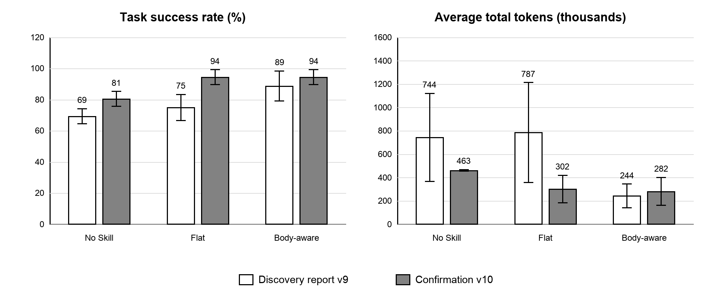

# 固定 Skill 检索对语言模型 Agent 表现和成本的影响

本文由已发布 PDF 对应的 Word 原稿转换，并逐段、逐单元格核对 PDF。保留当时的数据、表述和后续计划；不代表最新结论。当前综合说明见[项目说明与结果复核](../../docs/PROJECT_SUMMARY.md)。

ScienceWorld 发现实验和独立确认实验

## 摘要

本报告合并两批预先固定的 ScienceWorld 文字交互实验。发现实验收录在 ScienceWorld v9 正式实验报告中，包含 12 道任务、5 个条件和 3 次重复，共 180 个 episode。独立确认实验使用另外 12 道 test variation，只比较 No Skill、Flat Retrieval 和 Body-aware Retrieval，共 108 个 episode。成功标签全部来自环境分数，模型不能为自己评分。

发现实验中，Body-aware Retrieval 的成功率为 88.89%，No Skill 为 69.44%；成功率差为 19.44 个百分点，任务聚类 Bootstrap 95% 置信区间为 8.33 至 30.56 个百分点。Body-aware 的平均 Total Tokens 比 No Skill 低 67.19%。

独立确认实验中，Body-aware 与 Flat 的成功率均为 94.44%，No Skill 为 80.56%。Body-aware 相对 No Skill 高 13.89 个百分点，但成功率区间触及 0。其平均 Total Tokens 低 39.09%，任务级 Token 区间仍跨过 0。两批实验的点估计方向一致，但确认实验没有证明 Body-aware 的成功率稳定高于 Flat，也没有证明 Token 在多数任务上都会下降。

关键词  大语言模型 Agent  固定 Skill  Skill 检索  ScienceWorld  推理成本

## 一 研究问题和证据结构

研究关注两个问题。第一，人工固定的 Skill 能否提高交互任务成功率。第二，在成功率相近时，检索 Skill 正文是否比只检索名称和描述更节省推理开销。项目不训练 Router，不自动学习 Skill，也不使用 PPO。

发现实验用于识别信号，独立确认实验用于检验该方向能否在未使用的新 variation 上重复。两个实验使用相同的六类任务、Skill v3、Agent 协议和模型请求名称，但题目不重叠。

表 1  两批实验的设计

| 实验 | 内部运行编号 | 任务 | 条件 | 规模 |
| --- | --- | --- | --- | --- |
| 发现实验 对外报告 v9 | scienceworld-v6-router- formal-12x3 | 12 道新题 第 3 和第 4 个 test variation | 5 | 180 episodes |
| 独立确认实验 v10 | scienceworld-v10- confirm-12x3 | 12 道新题 第 5 和第 6 个 test variation | 3 | 108 episodes |

## 二 实验方法

### 实验条件

表 2  五种条件的 Skill 加载方式

| 条件 | 加载内容 | 选择依据 | 用途 |
| --- | --- | --- | --- |
| No Skill | 不加载 Skill | 无检索 | 普通 Agent 基线 |
| All Skills | 全部 6 个 Skill | 不检索 | 完整上下文条件 |
| Flat Retrieval | Top 3 Skill | Name 和 Description | 轻量检索基线 |
| Body-aware Retrieval | Top 3 Skill | 完整五字段正文 | 正文感知检索 |
| Oracle v3 | 人工 Gold Skill | 任务类型映射 | 已知正确 Skill 的上界 |

独立确认实验只保留 No Skill、Flat Retrieval 和 Body-aware Retrieval。这样可以直接检验真实可部署条件，避免继续为 All Skills 和 Oracle 支付 API 成本。

### 运行协议

表 3  两批实验共同使用的运行设置

| 项目 | 固定设置 |
| --- | --- |
| 模型请求名称 | deepseek-v4-flash |
| 采样 | temperature 0  thinking disabled |
| Agent 协议 | scienceworld-v2  每轮最多执行一个环境动作 |
| 环境 | ScienceWorld easy simplification  test split |
| 动作上限 | 每个 episode 最多 400 个环境步 |
| 重复 | 每道题每个条件 3 次  条件顺序按固定种子打乱 |
| 成功条件 | ScienceWorld 环境分数达到 100 |

六项核心指标为 Task Success Rate、Input Tokens、Output Tokens、Total Tokens、End-to-End Latency 和 Cost per Successful Task。成本按运行时记录的 Token 与实验代码中的价格表估算，用于条件间比较，不代表当前账单价格。

统计分析保持同一道题、同一次重复的配对关系。成功率和 Total Tokens 均以任务为重采样单位计算 20,000 次 Bootstrap 区间，并报告任务级精确符号检验。三次重复用于估计运行波动，不能当作三道独立任务。

## 三 实验结果

### 发现实验结果

表 4  ScienceWorld v9 报告中发现实验的六项核心指标

| 条件 | 成功率 % | Input Tokens | Output Tokens | Total Tokens | 延迟 秒 | 每成功任务 成本 USD |
| --- | --- | --- | --- | --- | --- | --- |
| No Skill | 69.44% ± 4.81 | 740,335 ± 375,985 | 3,557 ± 614 | 743,891 ± 376,227 | 73.83 ± 16.28 | $0.007158 ± 0.001640 |
| All Skills | 91.67% ± 0.00 | 653,760 ± 515,605 | 3,681 ± 1,730 | 657,441 ± 517,209 | 62.10 ± 15.38 | $0.004643 ± 0.002403 |
| Flat Retrieval | 75.00% ± 8.33 | 783,636 ± 426,332 | 3,219 ± 1,056 | 786,855 ± 427,382 | 71.04 ± 21.21 | $0.006609 ± 0.003254 |
| Body-aware Retrieval | 88.89% ± 9.62 | 241,813 ± 100,926 | 2,273 ± 1,019 | 244,086 ± 101,516 | 40.45 ± 7.98 | $0.002713 ± 0.001010 |
| Oracle v3 | 94.44% ± 4.81 | 279,928 ± 118,033 | 2,289 ± 542 | 282,217 ± 118,563 | 42.92 ± 6.43 | $0.002701 ± 0.000645 |

发现实验中，Body-aware 的成功率比 No Skill 高 19.44 个百分点。成功率区间完全高于 0，任务级符号检验 p=0.031。Body-aware 的平均 Total Tokens 低 67.19%，任务聚类 Token 区间也低于 0。Flat 的成功率只高 5.56 个百分点，平均 Total Tokens 反而增加 5.78%。

### 独立确认实验结果

表 5  ScienceWorld v10 独立确认实验的六项核心指标

| 条件 | 成功率 % | Input Tokens | Output Tokens | Total Tokens | 延迟 秒 | 每成功任务 成本 USD |
| --- | --- | --- | --- | --- | --- | --- |
| No Skill | 80.56% ± 4.81 | 460,745 ± 6,262 | 2,209 ± 41 | 462,953 ± 6,225 | 77.43 ± 7.76 | $0.004256 ± 0.000221 |
| Flat Retrieval | 94.44% ± 4.81 | 300,464 ± 117,273 | 1,888 ± 336 | 302,352 ± 117,579 | 55.83 ± 16.84 | $0.002704 ± 0.000743 |
| Body-aware Retrieval | 94.44% ± 4.81 | 280,219 ± 119,143 | 1,761 ± 211 | 281,980 ± 119,350 | 50.08 ± 13.76 | $0.002551 ± 0.000700 |

确认实验中，Flat 和 Body-aware 均成功 34 次，No Skill 成功 29 次。两种检索条件都比基线高 13.89 个百分点。Body-aware 的平均 Total Tokens 比 No Skill 低 39.09%，延迟低 35.32%，每个成功任务成本低 40.06%。

Body-aware 与 Flat 的成功率相同。Body-aware 的平均 Total Tokens 比 Flat 低 6.74%，延迟低 10.31%，每个成功任务成本低 5.65%。这些是总体均值差，不表示每道题都有相同变化。

图 1  两批实验在三个共同条件上的成功率和 Total Tokens  误差线为三次重复间标准差

### 配对推断

表 6  检索条件相对 No Skill 的任务级配对结果

| 实验和方法 | 成功率差 百分点 | 成功率 95% CI | 成功率 任务级 p | Total Tokens 变化 | Token 差 95% CI 千 Tokens | Token 任务级 p |
| --- | --- | --- | --- | --- | --- | --- |
| 发现实验 对外报告 v9 Flat Retrieval | +5.56 | [-5.56, 16.67] | 0.625 | +5.78% | [-651, 835] | 0.774 |
| 发现实验 对外报告 v9 Body-aware Retrieval | +19.44 | [8.33, 30.56] | 0.031 | -67.19% | [-1,199, -3] | 0.146 |
| 独立确认实验 v10 Flat Retrieval | +13.89 | [0.00, 33.33] | 0.250 | -34.69% | [-478, 31] | 0.774 |
| 独立确认实验 v10 Body-aware Retrieval | +13.89 | [0.00, 33.33] | 0.250 | -39.09% | [-519, 12] | 0.774 |

发现实验为 Body-aware 提供了较强的成功率证据。确认实验的改善方向相同，但成功率区间下界为 0，任务级 p=0.250，episode 级精确 McNemar 检验 p=0.0625。按照常用的 0.05 阈值，确认实验没有单独完成统计确认。

确认实验中，Body-aware 的任务聚类 Token 区间为负 518,502 至正 12,435，跨过 0。12 道题中 5 道更省、7 道更费，任务级符号检验 p=0.774。总体均值下降由少数高开销任务贡献，不能解释成多数任务上的固定节省。

## 四 检索和失败分析

表 7  检索命中与失败结果

| 实验和方法 | Gold Hit at 3 | 命中时 成功率 | 漏检时 成功率 | 失败 episodes | 动作预算 耗尽 |
| --- | --- | --- | --- | --- | --- |
| 发现实验 对外报告 v9 Flat Retrieval | 66.67% | 87.50% | 50.00% | 9 | 7 |
| 发现实验 对外报告 v9 Body-aware Retrieval | 83.33% | 93.33% | 66.67% | 4 | 2 |
| 独立确认实验 v10 Flat Retrieval | 66.67% | 100.00% | 83.33% | 2 | 2 |
| 独立确认实验 v10 Body-aware Retrieval | 75.00% | 92.59% | 100.00% | 2 | 2 |

发现实验中，Body-aware 的 Gold Hit at 3 为 83.33%，Flat 为 66.67%。确认实验中的差距缩小为 75.00% 对 66.67%。确认实验里，Body-aware 漏检时反而全部成功，说明 Gold Skill 排名不能单独解释结果，Top 3 中其他 Skill 和后续执行路径同样会改变成败。

确认实验共有 11 次失败，其中 10 次耗尽环境动作预算。No Skill 失败 7 次，Flat 和 Body-aware 各失败 2 次。检索条件减少了长轨迹失败，但 melt v025 在两种检索条件下仍各失败 2 次，Skill 并没有消除所有执行问题。

## 五 结果解释

### 固定 Skill 检索的效果可以重复

Body-aware 在两批互不重叠的任务上都比 No Skill 获得更高成功率和更低总体成本。确认实验中 Flat 也达到相同成功率，说明有效信号不只来自读取完整正文；在当前任务上，加载一组相关 Skill 本身可能已经减少无效探索。

### Body-aware 相对 Flat 的优势不稳定

发现实验中，Body-aware 的成功率和成本都优于 Flat。确认实验中两者成功率持平，只保留了总体成本优势。因此，现有证据支持继续研究正文感知检索，但不足以写成 Body-aware 在不同任务集上稳定优于 Flat。

### 平均 Token 需要结合任务分布解释

长轨迹任务会累计大量上下文，少数失败 episode 可以显著抬高平均 Input Tokens。发现实验和确认实验都出现这种右偏分布。报告保留总体均值，因为它反映实际推理支出；任务级区间和方向计数用于说明该均值是否由多数任务共同产生。

## 六 研究限制

- 两批实验共有 24 道独立 variation，但都来自相同六类 ScienceWorld 任务。结果不能外推到全部 ScienceWorld 或其他交互环境。

- Skill v3 在更早的任务上经过人工修订。确认题没有参与修订，但仍与开发题属于相邻任务族。

- hash-embedding-v1 是确定性本地检索基线，不代表预训练语义 embedding 或训练式 Router。

- API 请求名称和 temperature 被记录，服务端模型权重无法由客户端冻结。重复运行仍可能发生波动。

- 确认实验只包含 12 道独立任务。置信区间较宽，显著性结果对少量任务变化敏感。

## 七 结论

ScienceWorld v9 报告中的发现实验表明，Body-aware Retrieval 可以同时提高成功率并降低推理成本。v10 独立确认实验在新题上重复了相同方向：Body-aware 比 No Skill 高 13.89 个百分点，平均 Total Tokens 低 39.09%。确认实验的任务级统计证据不足，Flat 又取得相同成功率，因此不能据此声称正文感知检索已经稳定优于轻量检索。

当前最稳妥的结论是：固定 Skill 检索能在这组 ScienceWorld 长流程任务中减少失败和总体推理开销；Body-aware 是否具有独立且可迁移的优势，还需要更多预先固定的任务或其他环境验证。

## 八 复现信息

表 8  冻结数据和内部编号

| 对外名称 | 内部运行编号 | 记录数 | 冻结文件 SHA 256 |
| --- | --- | --- | --- |
| ScienceWorld v9 发现实验报告 | scienceworld-v6-router-formal-12x3 | 180 | c978ce0568f89fecaff48848327817cdd3493a18162df1bc0b99bcdaf9b043fd |
| ScienceWorld v10 独立确认实验 | scienceworld-v10-confirm-12x3 | 108 | d6614857fe39458c0e8f23e04c96d75d15d6b7f9cb90c131f0a391b6cfd9a4e2 |

对外版本号用于区分报告和确认阶段。内部运行编号、目录名和哈希用于复现，保留原值，不作追溯性重命名。

## 参考资料

1  Wang R  Jansen P  Cote M A  Ammanabrolu P  ScienceWorld Is your Agent Smarter than a 5th Grader  Proceedings of EMNLP 2022  11279 至 11298  DOI 10.18653/v1/2022.emnlp-main.775
