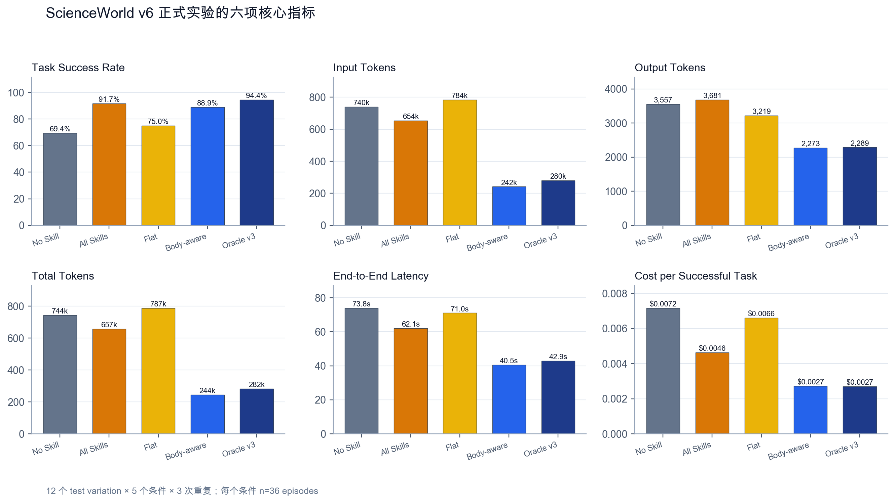
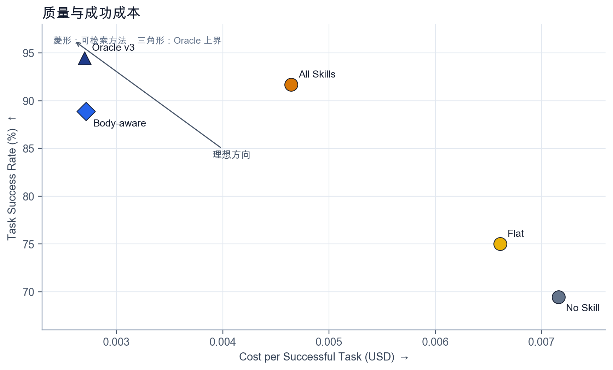
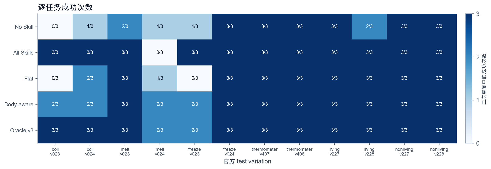
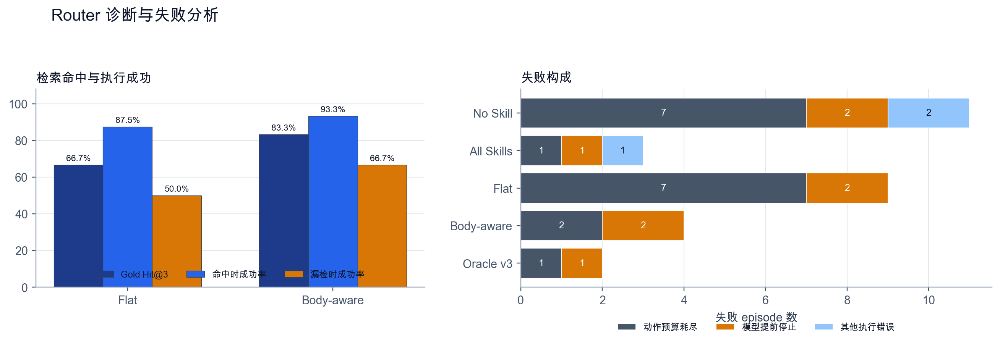

# ScienceWorld 固定 Skill 检索的效果与成本

本文由已发布 PDF 对应的 Word 原稿转换，并逐段、逐单元格核对 PDF。保留当时的数据、表述和后续计划；不代表最新结论。当前综合说明见[项目说明与结果复核](../../docs/PROJECT_SUMMARY.md)。

使用 deepseek-v4-flash 接口名称的五条件配对实验

| 项目 | 内容 |
| --- | --- |
| 运行编号 | scienceworld-v6-router-formal-12x3 |
| 实验规模 | 12 道任务  5 个条件  3 次重复  共 180 个 episode |
| 实验日期 | 2026 年 9 月 |
| 评分规则 | ScienceWorld 环境分数达到 100 记为成功 |

表1  报告范围与评分口径

## 摘要

本研究检验人工固定 Skill 的加载方式是否影响语言模型 Agent 在 ScienceWorld 文字环境中的任务成功率与推理成本。实验选取六类任务的 12 个官方 test variation，比较 No Skill、All Skills、Flat Retrieval、Body-aware Retrieval 和 Oracle v3。每个任务在每种条件下重复三次，共得到 180 个 episode。所有成功标签由环境分数计算，模型不能为自己评分。

Body-aware Retrieval 的成功率为 88.89%，No Skill 为 69.44%，差值为 19.44 个百分点。以任务为重采样单位的 Bootstrap 95% 置信区间为 8.33 至 30.56 个百分点。Body-aware 的平均 Total Tokens 为 244,086，比 No Skill 少 67.19%；平均延迟少 45.21%，每个成功任务的估算成本少 62.10%。Flat Retrieval 的成功率差只有 5.56 个百分点，置信区间跨过 0，平均 Total Tokens 反而增加 5.78%。

结果支持一个受限判断：在这组固定任务、当前 Skill 库和以 deepseek-v4-flash 为请求名称的模型服务上，检索时读取 Procedure 能提高质量并降低开销；只读取名称和描述没有稳定收益。任务级符号检验与 episode 级 McNemar 检验给出的证据强度不同，独立任务又只有 12 道，因此不能把这组结果外推到全部 ScienceWorld、其他模型或其他 Skill 库。

关键词  大语言模型 Agent  固定 Skill  Skill 检索  ScienceWorld  推理成本

## 一 研究问题与实验边界

研究问题有两个。第一，人工写定的执行 Procedure 能否提高交互任务的成功率。第二，如果多个方法取得相近质量，哪种方法消耗更少的输入 Token、输出 Token、时间和费用。本阶段不训练 Router，不自动学习 Skill，也不使用 PPO 或 Skill graph。

ScienceWorld 是面向基础科学任务的文字交互环境，Agent 需要观察场景、移动、操作物体、测量并改变物质状态 [1]。本实验覆盖 boil、melt、freeze、use-thermometer、find-living-thing 和 find-non-living-thing 六类任务，每类按固定规则选取第 3 和第 4 个官方 test variation。12 道题在 API 运行前固定，并用环境生成的 Gold path 验证可在 400 个环境步内达到 100 分。

## 二 实验设计

### 实验条件

| 条件 | 加载内容 | 选择方式 | 实验角色 |
| --- | --- | --- | --- |
| No Skill | 无 | 不检索 | 普通 Agent 基线 |
| All Skills | 全部 6 个 v3 Skill | 不检索 | 测试完整上下文的作用 |
| Flat Retrieval | Top 3 Skill | Name 与 Description | 轻量检索基线 |
| Body-aware Retrieval | Top 3 Skill | 完整五字段 Skill 正文 | 正文感知检索方法 |
| Oracle v3 | 人工 Gold Skill | 任务类型直接映射 | 已知正确 Skill 的上界 |

表2  五个实验条件  条件间只改变提供给模型的 Skill

Skill 库含 6 个手工条目。每个条目统一包含 Name、Description、Activation Condition、Procedure 和 Termination Condition。v3 版本保留六个 Skill 的名称，只修订了 boil、melt 和 freeze 三类状态变化流程。Oracle v3 依据任务类型加载一个人工 Gold Skill；它不承担真实路由成本，所以只用于估计上界。

Flat 与 Body-aware 均使用 hash-embedding-v1：程序把英文词和相邻二元词组哈希到 256 维带符号向量，再用余弦相似度返回 Top 3。Flat 只向检索器提供 Name 和 Description；Body-aware 提供完整 Skill。该方法是确定性本地基线，不是预训练语义向量模型。

### 运行协议

| 项目 | 固定设置 |
| --- | --- |
| 模型请求名 | deepseek-v4-flash（API 兼容名称） |
| 采样 | temperature 0  thinking disabled |
| Agent 协议 | scienceworld-v2  每轮只执行一个 act 调用并读取观察 |
| 环境 | ScienceWorld easy simplification  test split |
| 最大环境步 | 400 |
| 重复 | 每道任务每个条件 3 次  条件顺序按固定种子打乱 |
| 完整性 | 180 条记录  180 个唯一键  0 缺失  0 重复 |

表3  正式实验中保持不变的设置

每个 episode 保存完整动作轨迹、任务和 variation、重复编号、条件、加载 Skill、检索排名、环境分数、模型调用次数、Token、延迟与成本。冻结文件的 SHA 256 校验值写在复现信息中。

### 指标与统计

- Task Success Rate 等于成功 episode 数除以 episode 总数；环境分数达到 100 才算成功。

- Input Tokens 和 Output Tokens 分别累加一个 episode 内全部模型调用的输入与输出；Total Tokens 等于两者之和。

- End-to-End Latency 从 Agent 开始运行计时，覆盖模型调用、路由、环境动作和完成判定。

- Cost per Successful Task 等于一个条件内所有 episode 的估算费用之和除以成功数；失败 episode 的费用保留在分子中。

- Efficiency per 1k Tokens 等于成功率除以平均 Total Tokens，再乘 1000。平均分、工具调用和环境步数用于解释执行过程。

主比较采用同一道题、同一次重复的配对结构。成功率差的 95% 置信区间通过 20,000 次任务聚类 Bootstrap 计算，抽样时保留同一任务的三次重复。任务级精确符号检验把每道题的平均差分为改善、变差和持平；持平任务不进入二项检验。episode 级精确 McNemar 检验列作补充。任务与运行协议在正式实验前固定，但这套推断性检验在运行完成后补充，四项比较没有作多重检验校正。

## 三 总体结果

| 条件 | 成功 | 成功率<br>% | Input Tokens | Output Tokens | Total Tokens | 延迟<br>秒 | 成本每成功<br>USD |
| --- | --- | --- | --- | --- | --- | --- | --- |
| No Skill | 25/36 | 69.44 ± 4.81 | 740,335 ± 375,985 | 3,557 ± 614 | 743,891 ± 376,227 | 73.83 ± 16.28 | 0.007158 ± 0.001640 |
| All Skills | 33/36 | 91.67 ± 0.00 | 653,760 ± 515,605 | 3,681 ± 1,730 | 657,441 ± 517,209 | 62.10 ± 15.38 | 0.004643 ± 0.002403 |
| Flat Retrieval | 27/36 | 75.00 ± 8.33 | 783,636 ± 426,332 | 3,219 ± 1,056 | 786,855 ± 427,382 | 71.04 ± 21.21 | 0.006609 ± 0.003254 |
| Body-aware Retrieval | 32/36 | 88.89 ± 9.62 | 241,813 ± 100,926 | 2,273 ± 1,019 | 244,086 ± 101,516 | 40.45 ± 7.98 | 0.002713 ± 0.001010 |
| Oracle v3 | 34/36 | 94.44 ± 4.81 | 279,928 ± 118,033 | 2,289 ± 542 | 282,217 ± 118,563 | 42.92 ± 6.43 | 0.002701 ± 0.000645 |

表4  六项核心指标  数值为总体均值 ± 重复间标准差  每个条件 36 个 episode

| 条件 | 平均分 | 工具调用 | 环境步数 | 每千 Token 效率 |
| --- | --- | --- | --- | --- |
| No Skill | 79.56 ± 10.54 | 69.64 ± 15.76 | 111.89 ± 13.43 | 0.000934 ± 0.000364 |
| All Skills | 95.64 ± 0.38 | 50.08 ± 10.65 | 53.97 ± 10.97 | 0.001394 ± 0.001380 |
| Flat Retrieval | 90.14 ± 3.36 | 66.64 ± 21.13 | 102.78 ± 33.40 | 0.000953 ± 0.001219 |
| Body-aware Retrieval | 95.83 ± 3.61 | 38.69 ± 7.14 | 61.22 ± 26.86 | 0.003642 ± 0.002949 |
| Oracle v3 | 97.11 ± 2.50 | 39.64 ± 5.00 | 52.14 ± 8.56 | 0.003347 ± 0.002021 |

表5  补充过程指标  环境中的 wait 可一次消耗多个环境步



图1  五种条件的任务成功率与五项推理开销  所有绝对量柱形图从零开始

Body-aware Retrieval 相对 No Skill 的成功率高 19.44 个百分点。Input Tokens 少 67.34%，Output Tokens 少 36.10%，Total Tokens 少 67.19%，延迟少 45.21%，每个成功任务的成本少 62.10%。

All Skills 的成功率为 91.67%，接近 Oracle v3 的 94.44%，但平均 Total Tokens 是 Body-aware 的 2.69 倍。Flat Retrieval 只比 No Skill 高 5.56 个百分点，平均 Total Tokens 高 5.78%。



图2  任务成功率与每个成功任务成本  Oracle 是已知 Gold Skill 的上界  Body-aware 是成本最低的可检索方法

## 四 配对推断与证据强度

| 相对 No Skill | 成功率差<br>百分点 | 任务聚类 95% CI<br>百分点 | 条件独有<br>基线独有 | McNemar<br>p | 任务<br>改善变差持平 | 符号检验<br>p |
| --- | --- | --- | --- | --- | --- | --- |
| All Skills | +22.22 | 2.78 至 44.44 | 9/1 | 0.021 | 5/1/6 | 0.219 |
| Flat Retrieval | +5.56 | -5.56 至 16.67 | 4/2 | 0.688 | 3/1/8 | 0.625 |
| Body-aware Retrieval | +19.44 | 8.33 至 30.56 | 9/2 | 0.065 | 6/0/6 | 0.031 |
| Oracle v3 | +25.00 | 8.33 至 44.44 | 11/2 | 0.022 | 6/0/6 | 0.031 |

表6  成功率配对统计  p 值为双侧且未作多重比较校正

Body-aware 在 12 道任务中改善 6 道、没有变差、6 道持平，任务级符号检验 p=0.031；任务聚类 Bootstrap 区间完全高于 0。episode 级 McNemar p=0.065，略高于常用的 0.05 阈值。三次重复属于同一任务，不能把 36 个 episode 当成 36 道独立题。报告同时保留两种检验，不用其中一个替代另一个。

All Skills 的 episode 级 McNemar p=0.021，但任务级符号检验 p=0.219。它改善 5 道、损害 1 道、其余持平。Flat Retrieval 的 Bootstrap 区间包含 0，两种精确检验也没有支持稳定差异。Oracle v3 的上界结果方向最强，但它依赖预先知道 Gold Skill，不能直接当作部署方法。

## 五 检索与任务层面结果

| 检索器 | Gold 命中 | Hit at 3 | 命中时成功率 | 漏检时成功率 | 漏检任务 |
| --- | --- | --- | --- | --- | --- |
| Flat Retrieval | 24/36 | 66.67% | 87.50% | 50.00% | boil v023 v024  melt v023 v024 |
| Body-aware Retrieval | 30/36 | 83.33% | 93.33% | 66.67% | boil v023 v024 |

表7  在线检索结果  每个 variation 重复三次  因此同一漏检任务出现三条 episode

Flat 的 Gold Hit@3 为 66.67%，Body-aware 为 83.33%。Flat 在 boil 和 melt 各漏掉两个 variation；Body-aware 只漏掉两个 boil variation。两种方法在命中 Gold Skill 时都更容易成功，Body-aware 在命中与漏检两种情况下都取得更高成功率。检索命中与成功相关，但不能单独证明因果，因为 Top 3 中其他 Skill、任务难度和后续执行都会改变结果。



图3  12 道任务在五个条件下的成功次数  每个单元格分母为 3

差异集中在状态变化任务。No Skill 在 boil v023 三次全败，在 boil v024、melt v024 和 freeze v023 也不稳定。Body-aware 在这四道难题上都取得 2/3，其余八道均为 3/3。All Skills 唯一系统性失败是 melt v024 的 0/3，说明完整 Skill 上下文会帮助多数任务，也可能在个别长流程中形成干扰或拖长轨迹。

## 六 失败分析

| 条件 | 失败 | 动作预算耗尽 | 模型提前停止 | 其他执行错误 | 涉及任务 |
| --- | --- | --- | --- | --- | --- |
| No Skill | 11 | 7 | 2 | 2 | boil v023  boil v024  find-living-thing v228  freeze v023  melt v023  melt v024 |
| All Skills | 3 | 1 | 1 | 1 | melt v024 |
| Flat Retrieval | 9 | 7 | 2 | 0 | boil v023  boil v024  freeze v023  melt v024 |
| Body-aware Retrieval | 4 | 2 | 2 | 0 | boil v023  boil v024  freeze v023  melt v024 |
| Oracle v3 | 2 | 1 | 1 | 0 | freeze v023  melt v024 |

表8  29 个失败 episode 的规则化分类



图4  左图比较检索命中与成功率  右图按条件分解失败类型

29 次失败中，18 次耗尽环境动作预算，占 62.07%；8 次在环境未完成时模型停止，占 27.59%；3 次归入其他执行错误。No Skill 有 11 次失败，Flat 有 9 次，Body-aware 有 4 次，Oracle v3 有 2 次。失败减少的主要来源不是评分规则变化，而是困难状态变化任务中的轨迹缩短。

动作预算耗尽也暴露了一个系统因素。Agent 把完整历史继续送入模型，长 episode 的 Input Tokens 会快速累积；ScienceWorld 的 wait 还会一次推进十个环境步。因此，平均 Input Tokens 同时反映 Skill 文本长度、模型调用次数和轨迹是否及时结束，不能把它只解释成一次性 Prompt 长度。

## 七 结果解释

### 正文感知检索是当前最好的可部署条件

Body-aware 在可检索方法中同时取得更高成功率、更低 Total Tokens 和更低成功成本。它读取 Procedure 后将 Gold Hit@3 从 Flat 的 66.67% 提高到 83.33%，并把平均工具调用从 No Skill 的 69.64 次降到 38.69 次。现有证据更符合两段机制：Procedure 改善 Skill 排名，加载后的步骤约束又减少无效探索。实验没有把路由和执行分开随机化，所以这仍是机制解释，不是独立因果估计。

### 全部加载的质量较高但上下文代价仍大

All Skills 取得 91.67% 成功率，却平均使用 657,441 Total Tokens，是 Body-aware 的 2.69 倍。它相对 No Skill 的总 Token 仍然更少，是因为多数 episode 更快结束，而不是因为每次调用的 Prompt 更短。melt v024 的三次失败说明完整库也会在特定流程中产生干扰。

### Oracle 给出上界但不能替代 Router

Oracle v3 达到 94.44% 成功率和 97.11 平均分，每个成功任务的成本为 0.002701 美元。这个条件使用人工 Gold 标签，省去了真实检索错误。它说明 Skill 内容仍有改进空间，也给 Router 设定了可接近的目标；它不能用于声称系统已经实现同等的在线选择能力。

## 八 局限与结论

- 正式集只有 12 道独立任务。三次重复反映运行波动，不能替代更多任务；任务级检验的离散度仍高。

- 六类任务各有两个 variation，但 boil、melt 和 freeze 的长轨迹控制了大部分 Token 与失败差异。

- Skill v3 在此前 variation 上经过修订。v6 任务没有参与修订，但结论仍限于同一环境和相邻任务族。

- API 请求使用 deepseek-v4-flash 名称、temperature 0 和 scienceworld-v2 Agent 协议。官方文档在 2026 年 9 月 14 日将该名称列为兼容名称，并说明请求由 DeepSeek-V4.1-Flash 提供服务；客户端没有冻结服务端权重。temperature 为 0 也不能排除服务侧非确定性 [2]。

- hash-embedding-v1 是局部哈希检索基线。结果不能代表训练过的语义 embedding、重排器或其他 Router。

- 成本依据运行时记录的缓存命中、缓存未命中和输出 Token 估算。实验代码冻结的单价分别为每百万 Token 0.0028、0.14 和 0.28 美元；这些数值用于复现实验内比较，不等同于当前账单价格 [2]。

- 四个条件都与 No Skill 比较，p 值未作多重比较校正。Bootstrap 与精确检验是在运行后补充，适合描述证据强度，不应包装成预注册显著性检验。

这次正式实验给出了项目目前最清楚的正结果。Body-aware Retrieval 在预先固定的 ScienceWorld test variation 上比 No Skill 多成功 7 个 episode，并大幅减少平均 Token、延迟与成功成本。Flat Retrieval 没有稳定收益，说明只检索 Skill 名称和描述不足以支持复杂执行。现阶段可以写成“正文感知 Skill 检索在该固定套件上显示质量与成本的共同改善”，不能写成“Skill 对 LLM Agent 普遍有效”。

## 九 复现信息

| 字段 | 值 |
| --- | --- |
| 运行编号 | scienceworld-v6-router-formal-12x3 |
| 套件 | scienceworld-v6-router-formal-12 |
| 冻结记录 | 180 |
| 冻结文件 | results/formal_scienceworld_v6/scienceworld-v6-router-formal-12x3.jsonl |
| SHA 256 | c978ce0568f89fecaff48848327817cdd3493a18162df1bc0b99bcdaf9b043fd |
| 模型 | deepseek-v4-flash |
| Agent 协议 | scienceworld-v2 |
| 成功规则 | environment score &gt;= 100 |
| 分析输入 | condition_summary.csv  paired_statistics.csv  retrieval_summary.csv  failures.jsonl  task_summary.csv |

表9  冻结数据与分析来源

正式运行命令

```sh
.venv/scienceworld/bin/python scienceworld_experiment.py \
  --model deepseek-v4-flash --temperature 0 \
  --suite scienceworld-v6-router-formal-12 \
  --conditions no_skill,all_skills,flat_retrieval,body_aware_retrieval,oracle_v3 \
  --max-steps 400 --repeats 3 \
  --run-id scienceworld-v6-router-formal-12x3 --resume
```

分析命令

```sh
python3 analyze_scienceworld_formal.py results/scienceworld_results.jsonl \
  --run-id scienceworld-v6-router-formal-12x3 \
  --suite scienceworld-v6-router-formal-12 \
  --conditions no_skill,all_skills,flat_retrieval,body_aware_retrieval,oracle_v3 \
  --repeats 3 --output-dir results/formal_scienceworld_v6
```

## 参考资料

[1] Wang R, Jansen P, Côté M A, Ammanabrolu P. ScienceWorld Is your Agent Smarter than a 5th Grader. Proceedings of EMNLP 2022: 11279-11298. DOI 10.18653/v1/2022.emnlp-main.775. https://aclanthology.org/2022.emnlp-main.775/

[2] DeepSeek API Documentation. Models and Pricing. 访问日期 2026 年 9 月 14 日. https://api-docs.deepseek.com/quick_start/pricing
