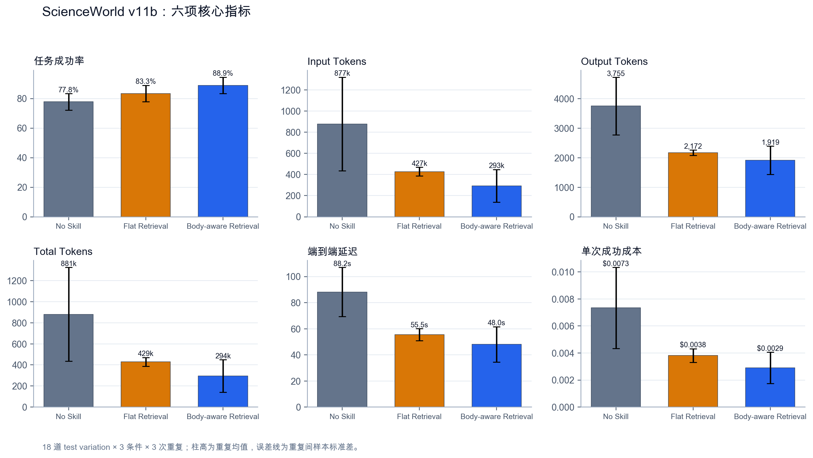
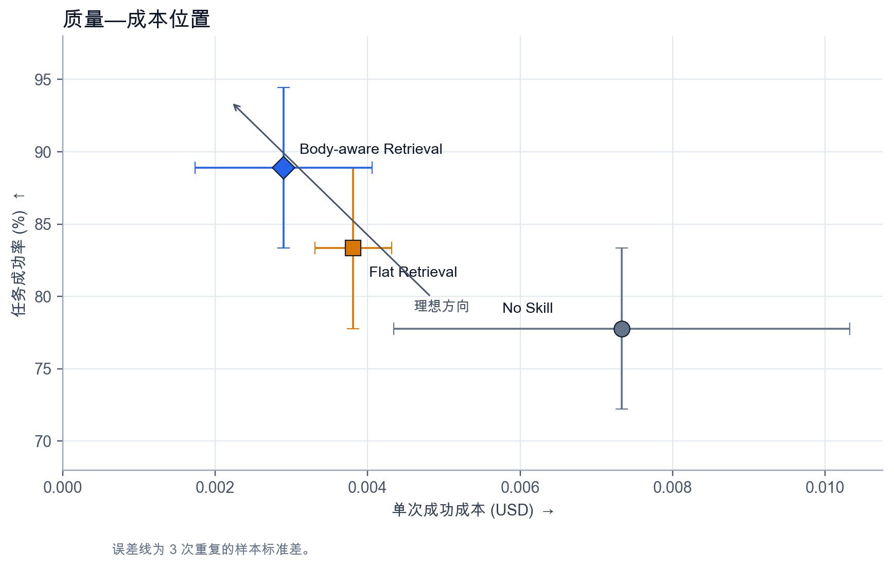
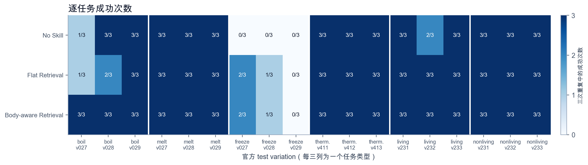
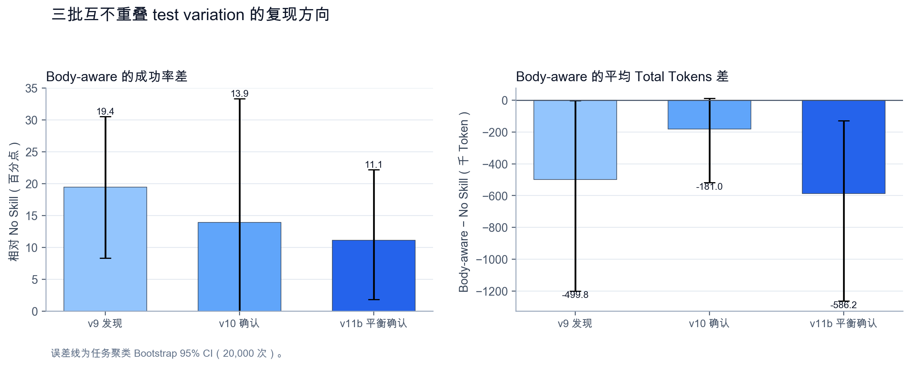

# ScienceWorld v11b 固定 Skill 检索平衡确认报告

## 摘要

本轮对 18 道互不重复的 ScienceWorld 官方 test variation 进行了平衡确认。六类任务各 3 道，比较 No Skill、Flat Retrieval 和 Body-aware Retrieval；每题每条件重复 3 次，共 162 个 episode。成功只由 ScienceWorld 返回的环境分数判定，阈值为 100 分，模型不参与评分。

Body-aware Retrieval 的成功率为 88.89%，高于 No Skill 的 77.78%，配对差值为 +11.11 个百分点。以任务为重抽样单位的 Bootstrap 95% CI 为 [1.85, 22.22] 个百分点，episode 级精确 McNemar 检验 `p=0.031`。其平均 Total Tokens 为 294,462，比 No Skill 少 66.57%；配对平均差为 -586,243，任务聚类 Bootstrap 95% CI 为 [-1,261,769, -128,184]。

这组数据支持一个有边界的结论：在当前模型、Skill 库、Router 和六类 ScienceWorld 任务中，Body-aware 固定 Skill 检索改善了平均成功率，也减少了平均推理开销。但收益集中在少数长轨迹任务，不能写成“Skill 在所有任务上普遍有效”。

## 1. 研究问题

实验检验两个问题：

1. Body-aware Retrieval 是否比 No Skill 提高任务成功率；
2. 这种加载方式是否以更少的 Token、时间和单次成功成本完成任务。

Flat Retrieval 是对照组。它只用 Skill 的 Name 和 Description 做 Top-3 检索；Body-aware Retrieval 还使用 Procedure 和 Termination Condition。两者的差别是检索索引中是否读取 Skill 正文，Agent、工具、环境与评分程序不变。

## 2. 实验设计

| 项目 | 设置 |
|---|---|
| Run ID | `scienceworld-v11b-confirm-18x3` |
| 模型 | `deepseek-v4-flash` |
| Temperature | 0 |
| Agent 协议 | `scienceworld-v2` |
| Skill 库 | 手工固定 v3，不在实验中学习或更新 |
| 检索数 | Top-3 |
| 任务 | 18 道；boil、melt、freeze、use-thermometer、find-living-thing、find-non-living-thing 各 3 道 |
| 重复 | 每题每条件 3 次 |
| 条件 | No Skill、Flat Retrieval、Body-aware Retrieval |
| 总量 | 18 × 3 × 3 = 162 episodes |
| 最大环境步 | 400 |
| 客观成功条件 | ScienceWorld score ≥ 100 |

原 v11 计划抽取 30 道题，预检时发现 `boil`、`melt` 和 `freeze` 的官方 test variation 只到 29，计划中的 30 和 31 不存在。该计划在 API 运行前作废，v11b 改为每类 3 道。作废记录与替代协议都保留在仓库。

## 3. 核心结果

表 1 报告 3 次重复的均值 ± 样本标准差。Cost per Successful Task 先在每次重复内计算，再汇总均值和标准差。

| Condition | Success Rate ↑ | Input Tokens ↓ | Output Tokens ↓ | Total Tokens ↓ | Latency (s) ↓ | Cost / Success (USD) ↓ |
|---|---:|---:|---:|---:|---:|---:|
| No Skill | 77.78% ± 5.56 | 876,950 ± 443,229 | 3,755 ± 978 | 880,705 ± 444,207 | 88.18 ± 18.77 | 0.007335 ± 0.002991 |
| Flat Retrieval | 83.33% ± 5.56 | 427,292 ± 41,754 | 2,172 ± 94 | 429,464 ± 41,800 | 55.52 ± 4.59 | 0.003812 ± 0.000502 |
| Body-aware Retrieval | **88.89% ± 5.56** | **292,543 ± 154,234** | **1,919 ± 478** | **294,462 ± 154,702** | **48.01 ± 13.60** | **0.002898 ± 0.001158** |



*Figure 1. 六项核心指标。误差线是 3 次重复的样本标准差。*

Body-aware 相对 No Skill 的描述性变化为：Input Tokens 减少 66.64%，Output Tokens 减少 48.89%，Total Tokens 减少 66.57%，端到端延迟减少 45.56%，重复均值口径的单次成功成本减少 60.50%。

| Condition | Average Score ↑ | Tool Calls ↓ | Environment Moves ↓ | Efficiency / 1k Tokens ↑ |
|---|---:|---:|---:|---:|
| No Skill | 90.19 ± 1.09 | 74.89 ± 12.73 | 107.96 ± 16.14 | 0.001039 ± 0.000474 |
| Flat Retrieval | 93.02 ± 3.06 | 48.91 ± 4.33 | 85.02 ± 15.89 | 0.001957 ± 0.000269 |
| Body-aware Retrieval | **94.85 ± 2.02** | **42.28 ± 11.79** | **68.93 ± 15.22** | **0.004187 ± 0.003345** |



*Figure 2. 成功率与单次成功成本。左上方代表更高成功率和更低成本。*

## 4. 配对推断

主分析把同一道题的三次重复保留在一个任务簇内，Bootstrap 以 18 道任务为重抽样单位，进行 20,000 次重抽样。McNemar 检验用配对 episode 的不一致结果；任务级符号检验只使用每道题的改善方向。

| Comparison | Success Diff. (pp) | Task-cluster 95% CI | McNemar p | Task + / − / = | Task sign p | Mean Total Token Diff. | Token 95% CI | Token lower / higher | Token sign p |
|---|---:|---:|---:|---:|---:|---:|---:|---:|---:|
| Flat − No Skill | +5.56 | [-3.70, 14.81] | 0.453 | 3 / 1 / 14 | 0.625 | -451,242 | [-1,152,541, 49,572] | 12 / 6 | 0.238 |
| Body-aware − No Skill | **+11.11** | **[1.85, 22.22]** | **0.031** | 4 / 0 / 14 | 0.125 | **-586,243** | **[-1,261,769, -128,184]** | 11 / 7 | 0.481 |
| Body-aware − Flat | +5.56 | [0.00, 14.81] | 0.250 | 2 / 0 / 16 | 0.500 | -135,001 | [-486,851, 101,200] | 5 / 13 | 0.096 |

Body-aware 对 No Skill 的平均成功率差和平均 Total Tokens 差的 Bootstrap 区间都没有跨过 0。这是本轮的主要支持证据。但任务级符号检验显示，成功率只在 4/18 道题上改善，其余 14 道持平；Token 是 11 道更低、7 道更高。符号检验丢弃了改善幅度，因此它与均值差的结果回答的不是同一个问题。

Flat Retrieval 的成功率和 Total Tokens 区间均跨过 0。Body-aware 相对 Flat 的成功率差为 +5.56 个百分点，但尚不能排除 0 差异；其平均 Token 更低，却有 13/18 道题的 Token 更高。少数大额节省控制了均值。

## 5. 逐任务与失败分析

| Task Family | No Skill | Flat Retrieval | Body-aware Retrieval |
|---|---:|---:|---:|
| boil | 7/9 | 6/9 | **9/9** |
| melt | 9/9 | 9/9 | 9/9 |
| freeze | 0/9 | **3/9** | **3/9** |
| use-thermometer | 9/9 | 9/9 | 9/9 |
| find-living-thing | 8/9 | **9/9** | **9/9** |
| find-non-living-thing | 9/9 | 9/9 | 9/9 |



*Figure 3. 18 道任务在三次重复中的成功次数。*

Body-aware 对 No Skill 的 6 个净增成功 episode 集中在 `boil`、`freeze` 和 `find-living-thing`。`melt`、`use-thermometer` 和 `find-non-living-thing` 在三个条件中均为 9/9，存在明显的天花板。Body-aware 对 Flat 的 3 个净增成功 episode 全部来自 `boil`。

全部 27 次失败中，No Skill 占 12 次，Flat 占 9 次，Body-aware 占 6 次。26/27 的失败类型是环境动作预算耗尽，绝大多数出现在 `boil` 和 `freeze`。剩余 1 次是 No Skill 在 `find-living-thing:v232` 用完 400 次 Agent 动作调用，环境内部计数为 264，未完成任务。

这个失败分布说明，Skill 的主要作用不是提高简单题上的上限，而是在需要状态转换和长时序操作的任务中减少循环与走错路。

## 6. Token 结果的稳健性

Body-aware 相对 No Skill 的平均 Total Tokens 降幅为 66.57%，但逐任务相对变化的中位数只有 -10.68%，逐任务 Token 差的中位数为 -5,649。均值与中位数相差很大，原因是 No Skill 在几道题上产生了极长轨迹：

- `find-living-thing:v232`：每题平均从 5,280,363 降到 25,061；
- `freeze:v027`：从 2,251,577 降到 478,871；
- `boil:v027`：从 1,890,001 降到 323,724。

留一任务法显示，任意删除 18 道题中的一道后，Body-aware 的总 Token 平均降幅仍在 50.10%–74.45% 之间。所以整体降幅不由单独一道题决定，但它仍是一个右偏、异质性很强的分布。报告均值时必须同时给出中位数和逐题方向。

## 7. Router 诊断

| Condition | Gold Hit@3 | Success if Hit | Success if Missed | 唯一漏检任务数 |
|---|---:|---:|---:|---:|
| Flat Retrieval | 66.67% (12/18) | 83.33% | 83.33% | 6 |
| Body-aware Retrieval | **83.33% (15/18)** | 86.67% | 100.00% | 3 |

Body-aware 的 Gold Hit@3 比 Flat 高 16.67 个百分点。但在本轮内，Flat 命中与漏检时的成功率相同；Body-aware 在漏检 Gold Skill 时反而 9/9 成功。因此不能把成功率改善直接归因于 Gold Hit@3 提高。可能的解释包括替代 Skill 提供了通用步骤、人工 Gold 标签不完整，或检索文本改变了模型的规划方式。现有数据不能在这三种解释中作出选择。

## 8. 跨批次复现

对外报告 v9、v10 和本轮 v11b 使用了相同模型、temperature、Agent 协议和 v3 Skill 库，三批任务互不重复，共 42 道 test variation。v9 是发现实验，v10 和 v11b 是后续确认。

| Study | Tasks | No Skill Success | Body-aware Success | Difference (pp) | Success 95% CI | No Skill Total Tokens | Body-aware Total Tokens | Relative Change |
|---|---:|---:|---:|---:|---:|---:|---:|---:|
| v9 发现 | 12 | 69.44% | 88.89% | +19.44 | [8.33, 30.56] | 743,891 | 244,086 | -67.19% |
| v10 确认 | 12 | 80.56% | 94.44% | +13.89 | [0.00, 33.33] | 462,953 | 281,980 | -39.09% |
| v11b 平衡确认 | 18 | 77.78% | 88.89% | +11.11 | [1.85, 22.22] | 880,705 | 294,462 | -66.57% |



*Figure 4. 三批互不重复任务的 Body-aware 对 No Skill 配对差。*

三批数据中，Body-aware 的成功率点估计均高于 No Skill，平均 Total Tokens 也均更低。如果将 42 道题做事后合并，No Skill 成功 96/126（76.19%），Body-aware 成功 114/126（90.48%），配对差为 +14.29 个百分点，任务聚类 Bootstrap 95% CI 为 [7.14, 22.22]。42 道题中 13 道改善、0 道变差、29 道持平，任务级精确符号检验 `p=0.00024`。平均 Total Tokens 差为 -445,755，95% CI 为 [-802,999, -166,445]。

这个合并分析是看完三批结果后进行的，只能用来检查方向一致性，不能代替 v11b 的预先固定主分析。

## 9. 局限

1. 实验只覆盖六个 ScienceWorld 任务类型，并且三类简单任务已接近或达到天花板。
2. 所有在线实验只用 `deepseek-v4-flash`。结果还没有跨模型复现。
3. Router 使用本地确定性哈希向量，不是预训练语义 embedding。本结果不代表所有 Body-aware Router。
4. 26 次失败在 400 个环境步处被截断。成功率反映固定计算预算下的完成能力，不是无限步数下的最终可解性。
5. Token 分布存在百万级长轨迹。平均值是重要的计算成本指标，但不能代表典型任务。
6. Gold Hit@3 与成功率在本轮中没有形成正向的组内对应。“Skill 被命中”和“Skill 导致改善”仍是两个不同的命题。

## 10. 结论

v11b 是目前最强的单批确认证据。Body-aware Retrieval 相对 No Skill 同时提高了平均成功率，并降低了平均 Token、延迟和单次成功成本。成功率的配对 Bootstrap 区间与 episode 级 McNemar 检验都给出正向证据，三批互不重复任务的方向也一致。

同时，不能把结论扩大为“Skill 已被普遍证明有效”。成功增益只出现在 4/18 道题，成本降幅受长轨迹影响明显，而且 Router 命中率无法直接解释执行改善。当前可以写成：**Body-aware 固定 Skill 检索在这三批 ScienceWorld 任务上呈现可复现的平均收益，优势主要来自减少困难长程任务中的无效交互。**

## 11. 复现信息

- 冻结轨迹：[`scienceworld-v11b-confirm-18x3.jsonl`](../../results/formal_scienceworld_v11/scienceworld-v11b-confirm-18x3.jsonl)
- SHA-256：`fb46b8f603d68f9e4baea76de912d68d1edac54299018b3b3bd51b7923177956`
- 条件汇总：[`condition_summary.csv`](../../results/formal_scienceworld_v11/condition_summary.csv)
- 配对统计：[`paired_statistics.csv`](../../results/formal_scienceworld_v11/paired_statistics.csv)
- 逐题结果：[`task_summary.csv`](../../results/formal_scienceworld_v11/task_summary.csv)
- 检索诊断：[`retrieval_summary.csv`](../../results/formal_scienceworld_v11/retrieval_summary.csv)
- 失败轨迹：[`failures.jsonl`](../../results/formal_scienceworld_v11/failures.jsonl)
- 敏感性与跨批次分析：[`derived_analysis.json`](../../results/formal_scienceworld_v11/derived_analysis.json)

重建派生统计与彩色图：

```bash
python3 analyze_scienceworld_v11.py
MPLCONFIGDIR=/tmp/fixedskilllab-matplotlib python3 plot_scienceworld_v11.py
```

校验冻结数据与程序：

```bash
python3 -m unittest -v
```
