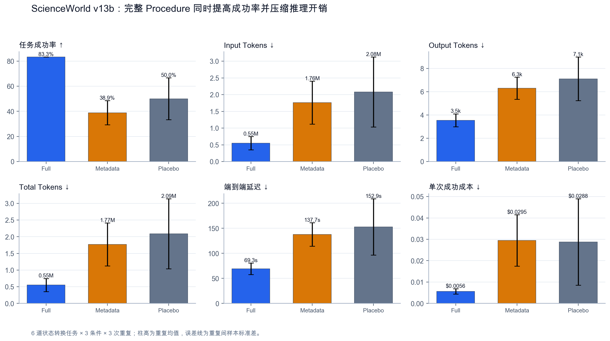
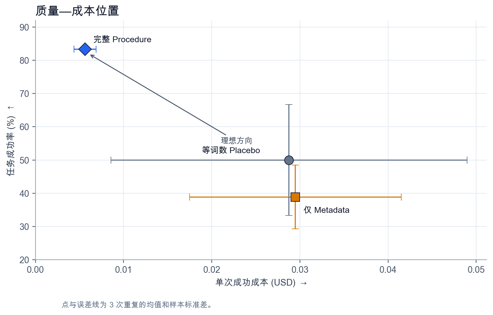
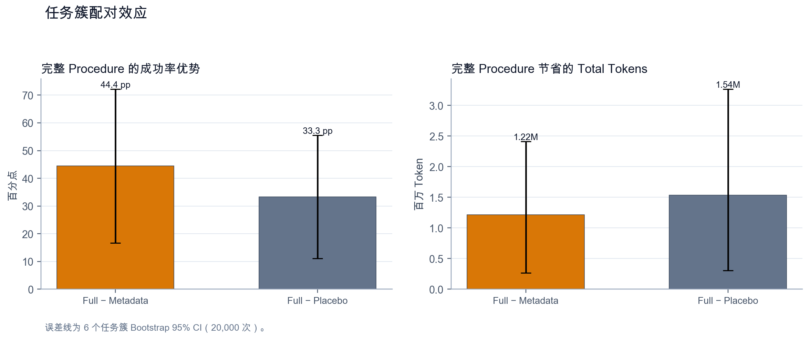
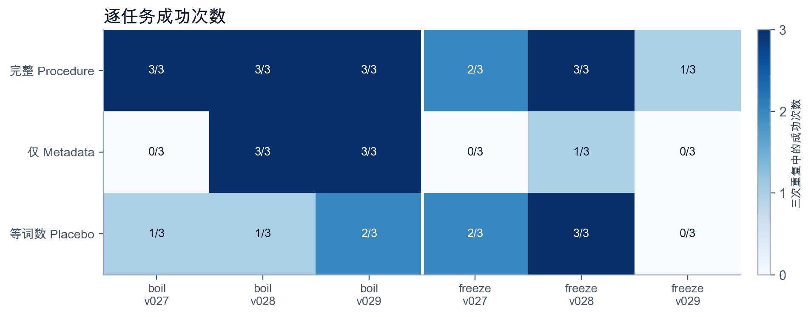

# ScienceWorld v13b：完整 Procedure 在状态转换任务中带来可重复的执行收益

## 摘要

v13b 比较同一个人工 Gold Skill 的三种呈现方式：完整 Procedure、仅 Metadata、等词数 Placebo。实验覆盖 `boil` 与 `freeze` 各 3 道官方 test variation，每题每条件重复 3 次，共 54 个 episode。三个条件使用同一模型、Agent 协议、Skill 名称和 400 步预算；没有 Router。ScienceWorld 环境分数达到 100 才算成功，模型不参与评分。

完整 Procedure 成功 15/18（83.33%），仅 Metadata 成功 7/18（38.89%），等词数 Placebo 成功 9/18（50.00%）。完整 Procedure 相对 Metadata 的配对差为 +44.44 个百分点，任务簇 Bootstrap 95% CI 为 [16.67, 72.22]；相对 Placebo 的差为 +33.33 个百分点，95% CI 为 [11.11, 55.56]。完整 Procedure 还把平均 Total Tokens 分别降低 68.84% 和 73.64%。

等词数 Placebo 保留 Name、Description 和 Activation Condition，只把 Procedure 与 Termination Condition 换成无关通用词。它与完整版本的空格分词数相同。因此，Full 对 Placebo 的结果排除了“提示更长就更有效”这一解释。v13b 支持一个窄结论：在定向选出的 `boil`、`freeze` 任务上，人工编写的 Procedure 内容改善了固定预算下的执行。它不估计整个 ScienceWorld 的平均收益，也不检验 Skill Router。

## 1. 研究问题

v11b 发现 Body-aware Retrieval 相对 No Skill 提高了成功率并减少了推理开销，但检索结果、Skill 数量和正文内容同时变化。v13b 固定 Skill 选择，只检验正文中的 Procedure 与 Termination Condition 是否提供增量价值。

主比较是 Full 对 Metadata。Full 对等词数 Placebo 是长度匹配的语义对照。

## 2. 实验设计

| 项目 | 设置 |
|---|---|
| Run ID | `scienceworld-v13b-oracle-mechanism-6x3` |
| 模型 | `deepseek-v4-flash` |
| Temperature | 0 |
| Agent 协议 | `scienceworld-v2` |
| Skill 库 | 人工固定 v3 |
| 任务 | `boil:v027–v029`、`freeze:v027–v029` |
| 重复 | 每题每条件 3 次 |
| 总量 | 6 × 3 × 3 = 54 episodes |
| 最大环境步 | 400 |
| 客观成功条件 | ScienceWorld score ≥ 100 |
| 配对键 | task name、variation、repeat |

三个条件都加载人工标注的一条正确 Skill：

| Condition | 加载内容 |
|---|---|
| Oracle v3 Full | Name、Description、Activation Condition、Procedure、Termination Condition |
| Oracle v3 Metadata | Name、Description、Activation Condition |
| Oracle v3 Placebo | 保留 Metadata；用无关通用词替换 Procedure 和 Termination Condition |

`boil-substance` 的 Full 与 Placebo 都是 156 个空格分词，`freeze-substance` 都是 151 个；Metadata 均为 26 个。逐 episode 检查确认三个条件加载的 Gold Skill 名称相同。

v13 Pilot 运行结束后，研究者根据方向性信号选择了 `boil` 和 `freeze`。六道题也曾在 v11b 中运行。协议在 v13b API 评估前冻结，但任务并非独立留出样本。

## 3. 六项核心指标

表 1 报告 3 次重复的均值 ± 样本标准差。Cost per Successful Task 先在每次重复内计算，再汇总均值和标准差。

| Condition | Success Rate ↑ | Input Tokens ↓ | Output Tokens ↓ | Total Tokens ↓ | Latency (s) ↓ | Cost / Success (USD) ↓ |
|---|---:|---:|---:|---:|---:|---:|
| Full | **83.33% ± 0.00** | **547,180 ± 198,710** | **3,545 ± 560** | **550,725 ± 199,237** | **69.28 ± 11.42** | **0.005627 ± 0.001243** |
| Metadata | 38.89% ± 9.62 | 1,761,311 ± 643,474 | 6,301 ± 956 | 1,767,612 ± 644,421 | 137.74 ± 23.54 | 0.029486 ± 0.012010 |
| Placebo | 50.00% ± 16.67 | 2,082,223 ± 1,045,877 | 7,113 ± 1,880 | 2,089,336 ± 1,047,619 | 152.87 ± 56.09 | 0.028761 ± 0.020195 |



*Figure 1. 六项核心指标。误差线为三次重复间的样本标准差。*

按全部 episode 合并计算，Full 相对 Metadata 的 Input Tokens、Output Tokens、Total Tokens 和延迟分别减少 68.93%、43.75%、68.84% 和 49.70%；单次成功成本减少 79.80%。Full 相对 Placebo 的对应降幅为 73.72%、50.17%、73.64%、54.68% 和 76.88%。

| Condition | Average Score ↑ | Tool Calls ↓ | Environment Moves ↓ | Efficiency / 1k Tokens ↑ | Median Total Tokens ↓ |
|---|---:|---:|---:|---:|---:|
| Full | **91.33 ± 0.00** | **78.61 ± 13.31** | **131.22 ± 11.58** | **0.001695 ± 0.000758** | **328,516** |
| Metadata | 73.39 ± 4.73 | 150.17 ± 24.03 | 262.50 ± 20.08 | 0.000244 ± 0.000118 | 2,285,742 |
| Placebo | 73.44 ± 9.48 | 158.78 ± 56.76 | 250.67 ± 88.50 | 0.000340 ± 0.000307 | 1,731,360 |

完整 Procedure 的静态提示比 Metadata 长，但累计 Input Tokens 更少。原因可从轨迹长度直接看到：Full 的平均 Tool Calls 约为 Metadata 的一半。该 Agent 在每轮调用中会再次发送对话历史，Procedure 减少循环后，节省的多轮上下文超过了 Skill 正文本身的开销。



*Figure 2. 成功率与单次成功成本。左上方代表更高成功率和更低成本。*

## 4. 配对推断

Bootstrap 以 6 道 task variation 为重抽样单位，共重抽样 20,000 次。McNemar 检验使用 18 个配对 episode；任务级符号检验先在每道题内汇总三次重复，因此只剩 6 个方向单位。

| Comparison | Success Diff. (pp) | Task-cluster 95% CI | Full-only / Control-only | McNemar p | Task + / − / = | Task sign p |
|---|---:|---:|---:|---:|---:|---:|
| Full − Metadata | **+44.44** | **[16.67, 72.22]** | 8 / 0 | 0.0078 | 4 / 0 / 2 | 0.125 |
| Full − Placebo | **+33.33** | **[11.11, 55.56]** | 7 / 1 | 0.0703 | 4 / 0 / 2 | 0.125 |

| Comparison | Mean Total Tokens Saved by Full | Task-cluster 95% CI | Full lower / higher | Token sign p |
|---|---:|---:|---:|---:|
| Full − Metadata | **1,216,887** | **[264,542, 2,415,009]** | 4 / 2 | 0.688 |
| Full − Placebo | **1,538,612** | **[306,595, 3,269,151]** | 5 / 1 | 0.219 |



*Figure 3. 完整 Procedure 相对两个对照的成功率优势与 Token 节省。误差线为任务簇 Bootstrap 95% CI。*

两个成功率 Bootstrap 区间都位于 0 以上。episode 级 McNemar 检验对主比较给出较小的 p 值，但 18 个 episode 来自 6 道重复任务，不能按 18 个独立任务解释。任务级符号检验的 `p=0.125` 反映了簇数量太少。报告因此同时保留区间、episode 配对结果和任务级方向，不用单个 p 值概括证据。

## 5. 逐任务结果

| Task | Full | Metadata | Placebo |
|---|---:|---:|---:|
| `boil:v027` | **3/3** | 0/3 | 1/3 |
| `boil:v028` | 3/3 | **3/3** | 1/3 |
| `boil:v029` | 3/3 | **3/3** | 2/3 |
| `freeze:v027` | **2/3** | 0/3 | **2/3** |
| `freeze:v028` | **3/3** | 1/3 | **3/3** |
| `freeze:v029` | **1/3** | 0/3 | 0/3 |



*Figure 4. 六道任务在三次重复中的成功次数。*

按任务类型汇总：

| Task family | Full Success | Metadata Success | Placebo Success | Full Avg Tokens | Metadata Avg Tokens | Placebo Avg Tokens |
|---|---:|---:|---:|---:|---:|---:|
| boil | **9/9** | 6/9 | 4/9 | **212,346** | 1,438,687 | 2,832,653 |
| freeze | **6/9** | 1/9 | 5/9 | **889,103** | 2,096,537 | 1,346,020 |

Full 在 `boil` 上没有失败，对 Placebo 增加 5 次成功。`freeze` 的差异较小，主要困难集中在 `freeze:v029`；Full 在该题也只成功 1/3。Procedure 改善了状态转换执行，但没有解决所有长轨迹问题。

## 6. 失败分析

54 个 episode 中有 23 次失败。Full 的 3 次失败都耗尽 400 个环境步；Metadata 的 11 次失败也全部耗尽预算。Placebo 有 7 次预算耗尽，另有 2 次在预算前因执行错误结束。

| Condition | Budget exhausted | Other execution error | Total failures |
|---|---:|---:|---:|
| Full | 3 | 0 | 3 |
| Metadata | 11 | 0 | 11 |
| Placebo | 7 | 2 | 9 |

失败分布与 Tool Calls、Environment Moves 一致。Full 的优势主要表现为减少循环并在固定预算内完成任务，不是把所有失败转成短轨迹成功。

## 7. 结论边界

v13b 给出了比 Router 实验更干净的机制证据：三个条件加载同一个 Gold Skill，等词数 Placebo 又控制了正文长度。完整 Procedure 在成功率、Token、延迟和成本上都优于两个对照。当前结果支持“具体执行步骤有用”，不支持“只要加载任意 Skill 文本就有用”。

这组结果有四个限制：

1. 研究者在 v13 Pilot 后选择 `boil` 和 `freeze`，因此效应估计带有任务选择偏差。
2. 六道题复用了 v11b variation，不能作为新的独立 held-out benchmark。
3. 统计推断只有 6 个任务簇；任务级符号检验未达到常用阈值。
4. 实验只使用 `deepseek-v4-flash`、一个人工 Skill 库和 400 步预算。

适合写进论文的结论是：**在定向选择的 ScienceWorld 状态转换任务中，完整的人工 Procedure 相比同一 Gold Skill 的 Metadata 和等词数无关正文，提高了固定预算下的任务完成率，并减少了多轮推理开销。**

## 8. 指标定义

\[
\mathrm{SuccessRate}=\frac{\text{成功 episode 数}}{\text{全部 episode 数}}
\]

\[
\mathrm{TotalTokens}=\mathrm{InputTokens}+\mathrm{OutputTokens}
\]

\[
\mathrm{CostPerSuccessfulTask}=\frac{\sum \mathrm{EpisodeCost}}{\text{成功 episode 数}}
\]

\[
\mathrm{Efficiency}_{1k}=\frac{\mathrm{SuccessRate}}{\mathrm{AverageTotalTokens}/1000}
\]

Latency 从 episode 提交开始计时，包含模型调用、环境动作和任务结束判断。Environment Score 与成功条件都由 ScienceWorld 返回。

## 9. 复现信息

- 冻结轨迹：[`scienceworld-v13b-oracle-mechanism-6x3.jsonl`](../../results/formal_scienceworld_v13b/scienceworld-v13b-oracle-mechanism-6x3.jsonl)
- SHA-256：`5e671e5c04d2e92a0041f8e5b74b0a0e89bfbaefd66c13a79314e904798a6692`
- 协议：[`scienceworld_v13b_oracle_mechanism_manifest.json`](../../results/scienceworld_v13b_oracle_mechanism_manifest.json)
- 条件汇总：[`condition_summary.csv`](../../results/formal_scienceworld_v13b/condition_summary.csv)
- 配对统计：[`paired_statistics.csv`](../../results/formal_scienceworld_v13b/paired_statistics.csv)
- 逐题结果：[`task_summary.csv`](../../results/formal_scienceworld_v13b/task_summary.csv)
- 失败轨迹：[`failures.jsonl`](../../results/formal_scienceworld_v13b/failures.jsonl)
- 衍生分析：[`derived_analysis.json`](../../results/formal_scienceworld_v13b/derived_analysis.json)

重建统计和图：

```bash
python3 analyze_scienceworld_formal.py results/scienceworld_results.jsonl \
  --run-id scienceworld-v13b-oracle-mechanism-6x3 \
  --suite scienceworld-v13b-oracle-mechanism-6 \
  --conditions oracle_v3_full,oracle_v3_metadata,oracle_v3_placebo \
  --repeats 3 \
  --output-dir results/formal_scienceworld_v13b \
  --purpose "targeted confirmation of fixed Skill Procedure content on state-change tasks"
python3 analyze_scienceworld_v13b.py
MPLCONFIGDIR=/tmp/fixedskilllab-matplotlib python3 plot_scienceworld_v13b.py
```

校验程序：

```bash
python3 -m unittest -v
```
